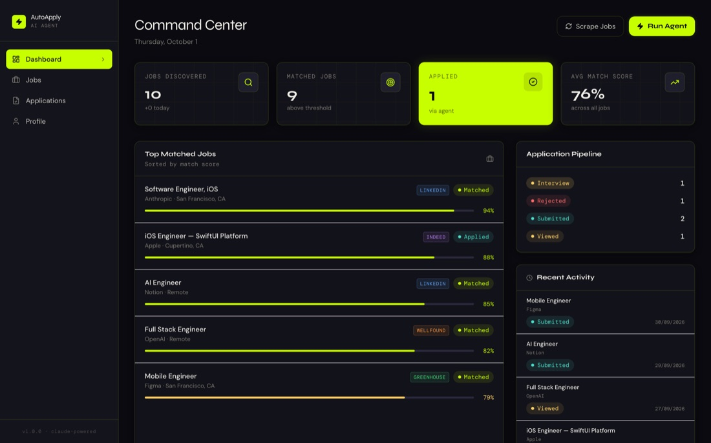
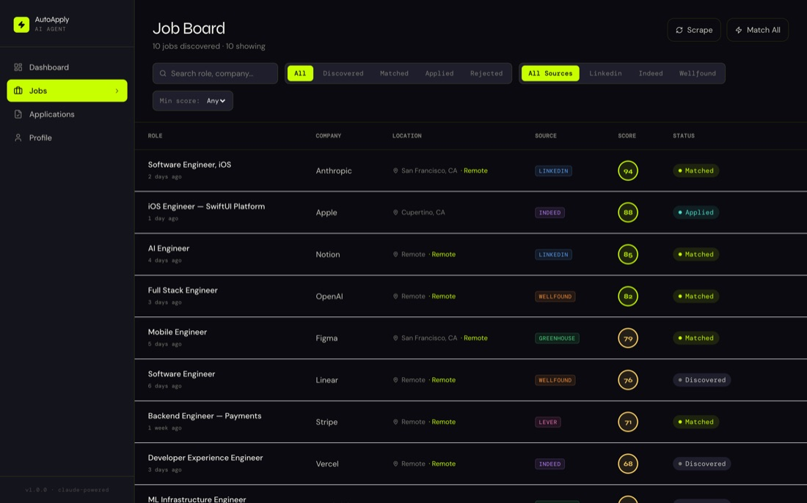
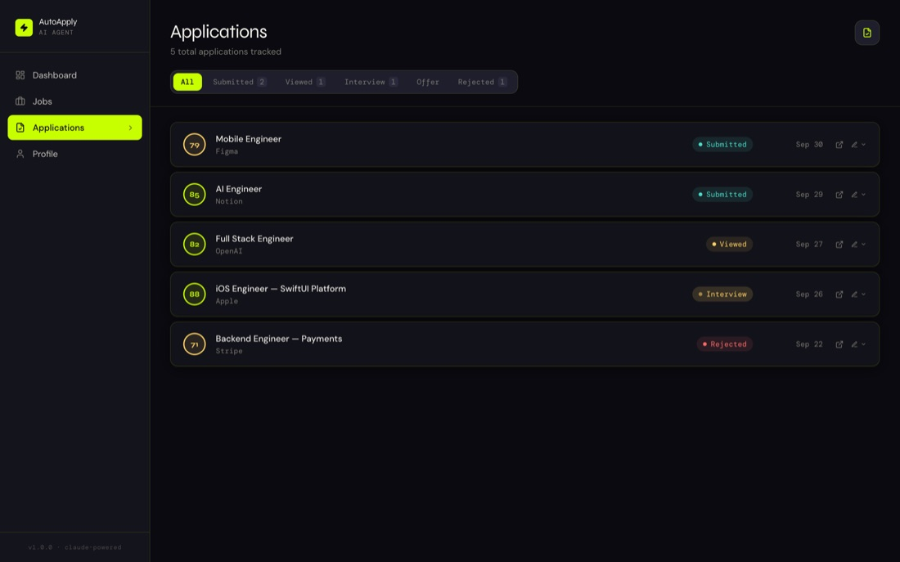

<div align="center">

# ⚡ AutoApply AI

**Your job search on autopilot. An AI agent that finds roles, scores how well you fit, tailors your resume and cover letter, and submits the application, all from one command center.**




</div>

---

## The problem

Applying for jobs is a second full-time job: search five boards, skim fifty listings, rewrite your resume for each one, write a cover letter, and fill out the same form again. Most of it is repetitive, but the parts that matter (*is this a good fit?*, *what should I emphasize?*) need judgment.

## What AutoApply does

```
 Scrape  →   Match   →   Tailor   →   Apply   →   Track
LinkedIn    Claude      résumé +     Playwright   pipeline
Indeed      scores      cover        fills the    dashboard
Wellfound   fit 0–100   letter       real form
```

| Stage | Agent | What happens |
|---|---|---|
| 🔎 **Discover** | `JobScraper` | Pulls fresh listings from **LinkedIn**, **Indeed** and **Wellfound** and fetches full job descriptions. |
| 🎯 **Match** | `JobMatcher` | Claude scores every job 0–100 against your profile and only those above your threshold move on. |
| ✍️ **Tailor** | `ResumeOptimizer`, `CoverLetterGenerator` | Rewrites your resume emphasis and drafts a role-specific cover letter for each match. |
| 🤖 **Apply** | `ApplicationBot` | Drives a real browser to submit on **Greenhouse**, **Lever**, **LinkedIn Easy Apply** and generic forms, handling text fields, dropdowns, radio groups and custom questions. |
| 📊 **Track** | Dashboard | Every application moves through *Submitted → Viewed → Interview → Offer / Rejected*. |

## Screens

<p align="center">
  
  
</p>

- **Command Center:** jobs discovered, matches, applications, average match score, top-matched jobs, pipeline breakdown and recent activity.
- **Job Board:** search and filter by status, source and minimum score, with one-click **Scrape** and **Match All**.
- **Applications:** a full history with status filters and links back to each posting.
- **Profile:** personal info, job targets and resume that the agents work from.

## Safety rails

- **Dry run by default.** Pipeline runs use `dry_run: true` unless you turn it off, so you can watch the agent work without anything being submitted.
- **Caps and thresholds.** `max_applications` per run (default 5) and a `min_match_score` gate keep it targeted.
- **Daily schedule.** APScheduler runs a fresh job search every morning at 8:00.

## Quick start

```sh
# Backend
cd backend
pip install -r requirements.txt && playwright install chromium
cp .env.example .env              # ANTHROPIC_API_KEY, DATABASE_URL, your contact details
python seed_demo.py               # optional: 10 demo jobs + 5 applications
uvicorn main:app --reload         # → http://localhost:8000

# Frontend
cd ../frontend
npm install && npm run dev        # → http://localhost:3000
```

## Tech

**Backend:** FastAPI, SQLAlchemy (async) with PostgreSQL, Anthropic Claude, Playwright, BeautifulSoup and APScheduler.
**Frontend:** Next.js 14 (App Router), TypeScript, Tailwind.

## About

Built by **Roszhan Raj**. *Screenshots show the bundled demo data from `seed_demo.py`.*
